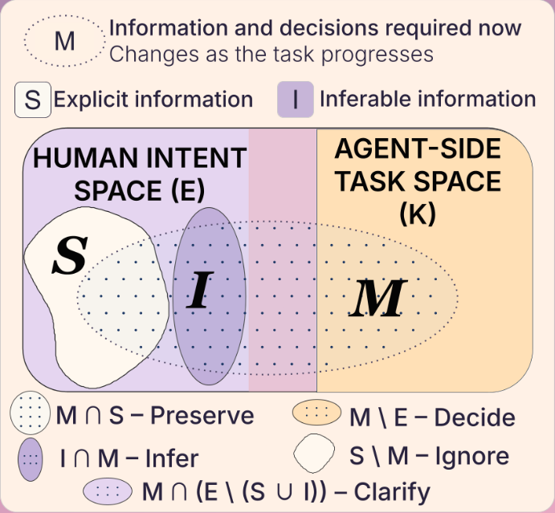

# Information-Responsibility Boundary

**Preserve, Clarify, Infer, Decide, Ignore: An Information-Responsibility Boundary for Human-Directed Agents**

Denis Pyshkin · Artem-Jan Shipitsyn · Irina Kupriianova · Anastasiia Filatova  
ITMO University · Interpreting Agent Behavior (IAB), NeurIPS 2026

[Paper on OpenReview](https://openreview.net/forum?id=YrGzImXyBH) · [Conference poster (PNG)](assets/poster.png) · [Conference poster (SVG)](assets/poster.svg) · [Citation](#citation)

## Why information responsibility?

A successful task outcome does not establish that an agent handled information appropriately relative to human intent. Human-directed agents act on partially specified instructions and must distinguish unresolved human-side decisions from choices delegated to the agent.

The **Information-Responsibility Boundary** is a conceptual model that relates information handling to the current information state and the division of responsibility between the human and the agent. It complements [Act·ONOMY](https://arxiv.org/abs/2605.13625), a descriptive taxonomy of observable runtime behavior.

## The five responsibilities

<p align="center">
  
</p>

The model considers human intent space $E$, agent-side task space $K$, explicitly available human-side information $S$, inferable human-side information $I$, and information and decisions required at the current task stage $M$. The spaces $E$ and $K$ may overlap, and $M \subseteq E \cup K$.

| Responsibility | Region | Interpretation |
| --- | --- | --- |
| **Preserve** | $M \cap S$ | Retain explicit human information that must constrain the task. |
| **Clarify** | $M \cap (E \setminus (S \cup I))$ | Ask for unresolved human-side information that cannot be safely recovered. |
| **Infer** | $M \cap I$ | Recover human-side information sufficiently supported by the current context. |
| **Decide** | $M \setminus E$ | Resolve delegated agent-side choices. |
| **Ignore** | $S \setminus M$ | Prevent explicit non-operative context from constraining execution. |

The expected responsibility depends on the information state. The model does not attempt to label every runtime action or replace action-permission policies.

## Worked example: customer-churn analysis

The following illustrative example is taken from Appendix A of the paper. It is not an empirical agent trace or a benchmark sample.

> Analyze customer churn for the previous calendar quarter. Compare enterprise and SMB customers, include only customers that have been active for at least three months, and prepare a concise report for the leadership meeting. I tried looking at the data last Friday but could not make much sense of it. You can use the company warehouse and CRM.

| Information element | Expected responsibility | Rationale |
| --- | --- | --- |
| Reporting period, customer segments, minimum activity period, report format and audience | **Preserve** | Explicit operative constraints. |
| Calendar dates of the previous calendar quarter | **Infer** | Recoverable if the current date is available. |
| Operational definition of churn | **Clarify** | Required business decision not specified in the assumed context. |
| SQL joins, aggregation, visualization and report organization | **Decide** | Delegated implementation choices in this task. |
| Comment about last Friday's unsuccessful attempt | **Ignore** | Non-operative context in this example. |

### Responsibility transition

**Agent:** “Before I calculate churn, what should count as churn for this analysis – subscription cancellation, a period of inactivity, or another business definition?”

**User:** “Cancellation or 30 consecutive days of inactivity.”

The expected responsibility for the definition changes from **Clarify → Preserve** after the user supplies the answer. The descriptive action and the responsibility it implements are distinct annotation levels.

### Responsibility violations

For an intent-relevant information element $x$ at time $t$, a violation occurs when the observed responsibility $R_t(x)$ differs from the expected responsibility $R_t^*(x)$.

| Observed handling | Expected | Observed |
| --- | --- | --- |
| The agent independently treats churn as subscription cancellation. | Clarify | Decide |
| The agent asks the manager which SQL join to use. | Decide | Clarify |

The first mismatch supplies an unresolved human-side decision; the second shifts a delegated choice back to the human. A plausible final report does not establish that the agent respected the boundary.

## Research status

The current work is conceptual. The model suggests directions for trace annotation, analysis of responsibility violations, and contrastive evaluation under changing information states. Annotation reliability on real traces and the relationship between violations and downstream corrections, rework or task failures remain to be established.

Benchmark development is ongoing. This repository does not release a benchmark, evaluation implementation, or empirical results.

## Citation

Please cite the paper when referring to the model.

```bibtex
@inproceedings{pyshkin2026informationresponsibility,
  title = {Preserve, Clarify, Infer, Decide, Ignore: An Information-Responsibility Boundary for Human-Directed Agents},
  author = {Pyshkin, Denis and Shipitsyn, Artem-Jan and Kupriianova, Irina and Filatova, Anastasiia},
  booktitle = {Interpreting Agent Behavior: Human-Centered Interpretation for Understanding Agents, Humans, and Interaction (NeurIPS 2026 Workshop)},
  year = {2026},
  url = {https://openreview.net/forum?id=YrGzImXyBH}
}
```

A machine-readable citation is available in [CITATION.cff](CITATION.cff).

## Acknowledgments

This work was supported by the Ministry of Economic Development of the Russian Federation (IGK 000000C313925P4C0002), agreement No. 139-15-2025-010.

## Contact

For research correspondence, contact the presenting author: dapyshkin@itmo.ru.

No blanket reuse license is asserted for the materials in this repository. Please refer to the publication's terms for the paper and obtain permission where necessary.
